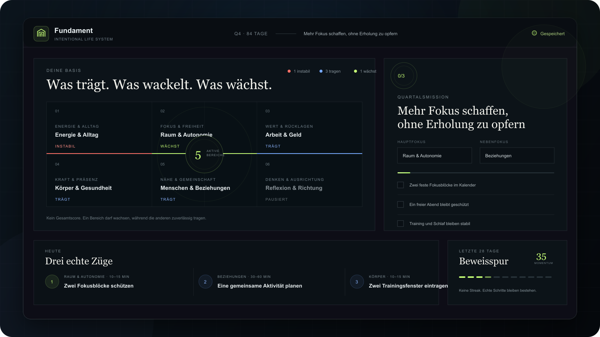
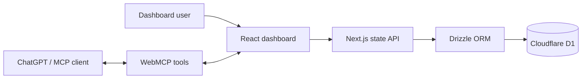

**[Open the interactive sample demo ↗](https://mduransu-maker.github.io/fundament/)** — synthetic data, no sign-in, no persistence. The personal hosted instance remains private.

<p align="center">
  
</p>

<h1 align="center">Fundament</h1>

<p align="center">
  A calm personal dashboard for what carries, what wobbles, and what grows.
</p>

<p align="center">
  <sub>Ein ruhiges Lebensdashboard für Fokus, konkrete nächste Schritte und Fortschritt ohne Streak-Druck.</sub>
</p>

<p align="center">
  <a href="https://github.com/mduransu-maker/fundament/actions/workflows/ci.yml"></a>
  
  
  
  
  
</p>

---

Fundament turns six areas of life into one clear quarterly direction and no more than three actionable next steps.

Instead of rewarding endless activity, it asks a simpler question: **What needs stability, what should keep carrying, and what is ready to grow?**

The current interface is in German. This README documents the project in English for portfolio use.

> The hosted instance is intentionally private because it stores personal data. The visual above and all repository defaults use a neutral demo profile.

## Product principles

| Foundation first | Three real actions | Evidence over pressure |
| --- | --- | --- |
| Each area is marked as fragile, stable, growing, or paused. | The daily view contains at most three prioritized tasks. | Completed steps form a lasting evidence trail instead of a streak that resets. |
| The user controls every status change. | Every task can be completed, reduced, postponed, or removed. | Momentum reflects recent effort without deciding progress for the user. |

## What it does

- Maps six configurable life areas in one visual foundation
- Separates **fragile**, **stable**, **growing**, and **paused** areas
- Defines one primary and one optional secondary quarterly focus
- Generates predictable task suggestions from current priorities
- Limits the active daily list to three tasks
- Turns an overwhelming task into a ten minute version
- Tracks completed work across a rolling 28 day window
- Saves changes automatically to Cloudflare D1
- Keeps each signed-in user's state isolated
- Exposes core actions through WebMCP
- Adapts from a wide desktop dashboard to smaller screens

## Interaction model

The status model stays intentionally small:

- **Red** — currently unstable and needs a controllable next step
- **Base** — stable enough to maintain
- **Growth** — ready for deliberate investment
- **Paused** — consciously outside the current plan

Points never promote or demote an area. The dashboard provides information; the user keeps control.

## How prioritization works

1. The quarterly plan defines a primary and secondary area.
2. Fragile areas receive additional priority.
3. Disabled areas produce no tasks.
4. The deterministic suggestion engine fills open slots.
5. Only the three highest priority actions appear in the daily view.

The rules are deterministic on purpose: suggestions remain understandable, predictable, and easy to change.

## Architecture



The dashboard uses a versioned state document with debounced autosave. The API validates the complete payload with Zod, limits its size, scopes it to the signed-in user, and upserts it into D1.

WebMCP is implemented as progressive enhancement. The dashboard continues to work normally when `document.modelContext` is unavailable.

## WebMCP tools

| Tool | Purpose |
| --- | --- |
| `read_foundation` | Read active areas, quarterly focus, and current tasks |
| `set_foundation_area_status` | Change an area to red, base, or growth |
| `add_foundation_task` | Add a concrete task to an active area |
| `complete_foundation_task` | Complete a task and update the evidence trail |

## Stack

| Layer | Technology |
| --- | --- |
| Interface | React 19, Next.js 16, TypeScript |
| Components | shadcn/ui, Base UI, Lucide |
| Styling | Tailwind CSS 4, custom responsive CSS |
| Runtime | Vinext on Cloudflare Workers |
| Persistence | Cloudflare D1, Drizzle ORM |
| AI interface | WebMCP |
| Hosting | OpenAI Sites with private ChatGPT sign-in |

## Run locally

### Requirements

- Node.js `>=22.13.0`
- npm
- Git

```bash
git clone https://github.com/mduransu-maker/fundament.git
cd fundament
npm run install:ci
npm run build
```

Apply the included D1 migration once:

```bash
node --import ./scripts/sites-env.mjs \
  ./node_modules/wrangler/bin/wrangler.js d1 execute DB \
  --local \
  --config dist/server/wrangler.json \
  --persist-to .wrangler/state \
  --file drizzle/0000_flimsy_magma.sql
```

Start the development server:

```bash
npm run dev
```

Open `http://127.0.0.1:5173`.

## Project structure

```text
app/
├── api/state/route.ts     # Persistent state API
├── globals.css            # Visual system and responsive layout
└── page.tsx               # Dashboard and WebMCP integration
db/
└── schema.ts              # D1 schema
drizzle/
└── 0000_flimsy_magma.sql  # Initial migration
lib/
└── foundation.ts          # Domain model and suggestion engine
```

## Privacy

The production deployment is private and protected through ChatGPT sign-in. Every signed-in user receives an isolated D1 record. Dashboard state is never committed to the repository.

The repository ships with sanitized demo data so the product can be explored without exposing a real person's plans or history.

## Roadmap

- Neutral first run onboarding
- Weekly review and quarter rollover
- Import and export
- Public read-only demo mode
